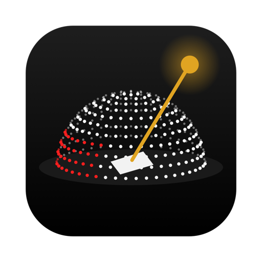
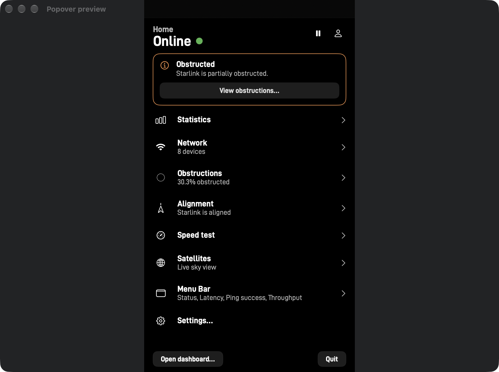
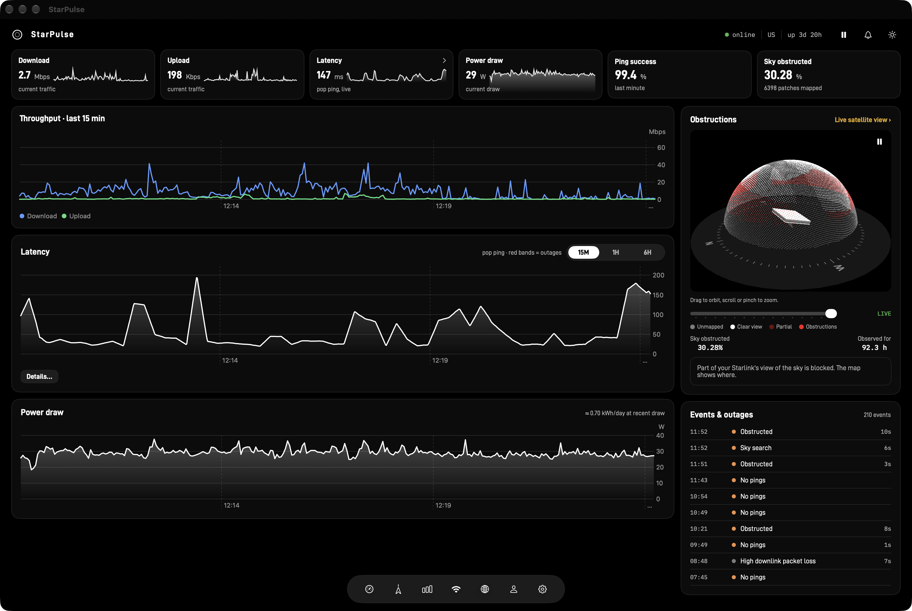

<div align="center">



# StarPulse: Starlink monitor for the Mac menu bar

**Native macOS app (Swift, SwiftUI) that reads your Starlink dish and router directly over your
local network: live latency, throughput, obstructions, satellites, connected devices, speed test,
device pause and DNS filtering rules.**

[](https://github.com/paulo-amaral/starlink-macos-menubar/actions/workflows/ci.yml)
[](https://github.com/paulo-amaral/starlink-macos-menubar/actions/workflows/codeql.yml)
[](https://github.com/paulo-amaral/starlink-macos-menubar/releases)


[](LICENSE)

[Download](https://github.com/paulo-amaral/starlink-macos-menubar/releases/latest) ·
[Screens](docs/screens.md) · [DNS filtering](docs/dns-filtering.md) ·
[Architecture](docs/architecture.md) · [Security](SECURITY.md)

</div>

> [!IMPORTANT]
> StarPulse is an unofficial, independent project with no affiliation to SpaceX or Starlink.
> Starlink is a trademark of Space Exploration Technologies Corp.

<p align="center">
  
</p>

<p align="center">
  
</p>



## Why StarPulse

- **Local data, no cloud dependency.** Status, history and obstruction maps come from the dish's
  gRPC-web API at `192.168.100.1:9201`; devices and nodes come from the Starlink router at `:9001`.
- **Native and light.** A Swift package with no third-party dependencies. It lives in the menu bar
  and does not appear in the Dock.
- **Close to the Starlink app.** The layout, the D-DIN typeface and the statistics cards follow the
  official app, so the numbers read the way you already know.
- **Open source, MIT.** Fork it, build it locally, change it.

## Features

| Area | What you get |
|---|---|
| Menu bar | Choose the readouts: status dot, latency, ping success, download/upload, power |
| Popover | Status, alerts, live throughput, latency and a shortcut to every panel |
| Dashboard | Tiles, throughput and latency charts (15 min, 1 h, 6 h), power, events and outages |
| Statistics | Starlink-style cards: download, upload, latency, ping success, outages, obstructions |
| Latency | Starlink PoP latency against the router, average and current, distribution |
| Obstructions | 3D sky dome from the dish's obstruction map, with an hourly time-lapse (last 48 h) |
| Satellites | Live Starlink satellites over your sky (SGP4 from CelesTrak data) and the likely serving one |
| Alignment | Azimuth, elevation, pointing error and tilt against the dish's own target |
| Network | Devices with live per-device throughput, details, history; mesh nodes |
| Device pause | Pause and resume devices, like the Starlink app (requires Starlink sign-in) |
| Rules | Schedules, daily data limits, timers and network DNS filters |
| DNS filtering | Cloudflare for Families, Quad9 and dnsforge presets, plus per-device guides for DNSBunker and dnsforge |
| Speed test | Download and upload against Cloudflare, with a speedometer gauge; latency, jitter, loss and a bufferbloat grade from the dish |
| Settings | Dish and router settings shown read-only; menu bar readouts, theme, dish address, account |

Every screen is described with a screenshot in **[docs/screens.md](docs/screens.md)**.

## Install

### Option 1: download the app

1. Download `StarPulse-<version>-macOS.zip` from
   [Releases](https://github.com/paulo-amaral/starlink-macos-menubar/releases/latest) and unzip it.
2. Move `StarPulse.app` to `/Applications`.
3. The build is **not notarized by Apple**, so Gatekeeper blocks the first launch. Either
   Control-click the app and choose **Open**, or run:

   ```bash
   xattr -dr com.apple.quarantine /Applications/StarPulse.app
   ```

4. Allow **Local Network** access when macOS asks. Without it the app cannot reach the dish or router.

The release zip is built by the maintainer from the tagged source and signed ad hoc. If you prefer
not to trust a binary, build it yourself (option 2).

### Option 2: build from source

Requirements: macOS 14 or later and Xcode 16 or later (Swift 6).

```bash
git clone https://github.com/paulo-amaral/starlink-macos-menubar.git
cd starlink-macos-menubar
swift test                    # unit tests, no hardware needed
scripts/bundle.sh release     # creates build/StarPulse.app
open build/StarPulse.app
```

## Requirements

- A Starlink kit on the same network as the Mac. The dish answers at `192.168.100.1`.
- Router features (devices, nodes, pause, rules) need a **Starlink router**. The router address is detected from the default gateway; you can change it in Settings.
- Device pause, network DNS rules and account details need you to **sign in with your Starlink
  account** (Settings → App → Account).

## How it works

```
 Mac (StarPulse)
  ├─ gRPC-web over HTTP ──► Dish   192.168.100.1:9201   status, history, obstruction map, config
  ├─ gRPC-web over HTTP ──► Router <gateway>:9001       clients, mesh nodes, Wi-Fi config (read)
  ├─ HTTPS ───────────────► starlink.com                account, device pause, DNS (signed in)
  ├─ HTTPS ───────────────► celestrak.org               orbital elements (once, cached)
  └─ HTTPS ───────────────► speed.cloudflare.com        speed test (on demand)
```

The protobuf messages are read and written by a small hand-written decoder, so the app needs no
protobuf library. Details in [docs/architecture.md](docs/architecture.md).

## DNS filtering

The Starlink router has no URL or HTTPS filter. StarPulse offers DNS-based filtering instead:

- **Network-wide presets** set through rules: Cloudflare for Families (blocks malware and adult
  content), Quad9 (malware), dnsforge Normal, Clean or Hard.
- **Per-device guides** for DNSBunker and dnsforge: Apple configuration profiles, Android Private DNS
  and browser secure DNS, so filtering also works away from home.

What each provider blocks, how rules switch between them, and the limits of DNS filtering are in
**[docs/dns-filtering.md](docs/dns-filtering.md)**.

## Limitations

- **Unofficial interfaces.** Starlink does not publish the local API or the account endpoint that
  pause and DNS use. A firmware update can change or remove them. Read-only features keep working
  more often than writes.
- **Writes need the cloud.** The router accepts setting changes only through the signed-in
  starlink.com session, not over the LAN.
- **Not a parental control system.** DNS filtering is easy to bypass (a device can set its own DNS,
  use a VPN or DNS-over-HTTPS). Rules run only while StarPulse is running on a Mac on that network.
- **No URL, keyword or HTTPS filtering**, and no per-device DNS on the router; DNS rules are
  network-wide.
- **Satellite view is an estimate.** It shows the satellites in view and the most likely serving one;
  Starlink does not report which satellite serves you.
- **Short history.** Charts use the dish's ring buffer (about 15 minutes at 1 s) plus what the app
  collects while open; there is no long-term database.
- **Not notarized.** See the Gatekeeper note above.
- Tested on a single Starlink kit and router so far; other kits and firmware may behave differently.

## Privacy and security

No analytics, no tracking, no third-party SDKs. The Starlink password is never seen by the app; only
the session cookie is kept in your Keychain. Before any write to the router, StarPulse re-reads its
configuration and verifies that nothing except the intended change will be sent. Full details and
how to report a vulnerability: **[SECURITY.md](SECURITY.md)**.

## FAQ

**Does it work without a Starlink router (third-party router in bypass mode)?**
The dish data works if the Mac can reach `192.168.100.1`. Devices, nodes, pause and rules need the
Starlink router.

**Does it need the Starlink app or an account?**
No for monitoring. Yes (sign-in) for pause, network DNS rules and account details.

**Will it slow my connection?**
Polling stays on your local network. Only the speed test loads your Starlink link.

**Can I see which satellite I am connected to?**
Not exactly; see Limitations.

## Contributing

Issues and pull requests are welcome. Read [CONTRIBUTING.md](CONTRIBUTING.md) and the
[Code of Conduct](CODE_OF_CONDUCT.md). If StarPulse is useful to you, a star helps others find it.

## Acknowledgments

StarPulse is a Swift port of the ideas and protocol work in
[Dishylink](https://github.com/DaveyHert/dishylink) (MIT) by daveyhert. Fonts: D-DIN (Datto, OFL)
and IBM Plex Mono (IBM, OFL). Orbital data: [CelesTrak](https://celestrak.org). See
[THIRD-PARTY-NOTICES.md](THIRD-PARTY-NOTICES.md).

## License

[MIT](LICENSE).

StarPulse is an unofficial, independent project with no affiliation to SpaceX or Starlink.
Starlink is a trademark of Space Exploration Technologies Corp.
