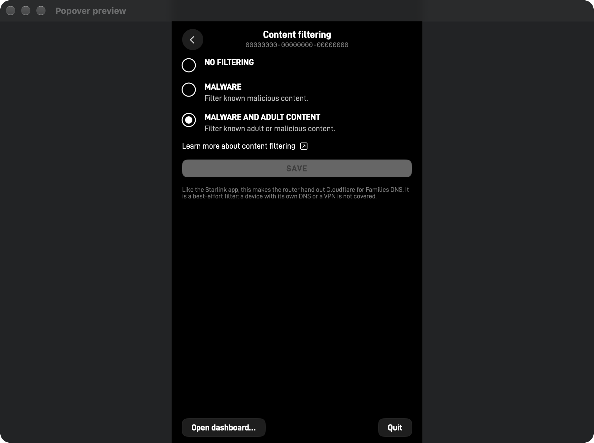
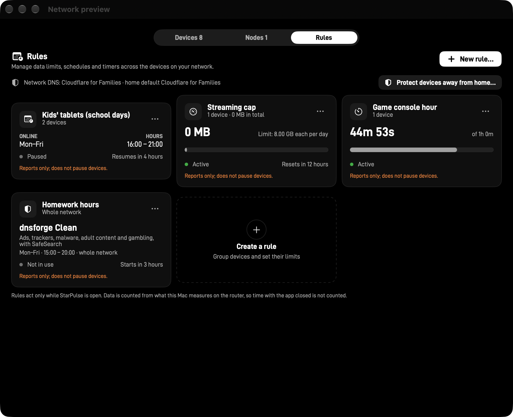
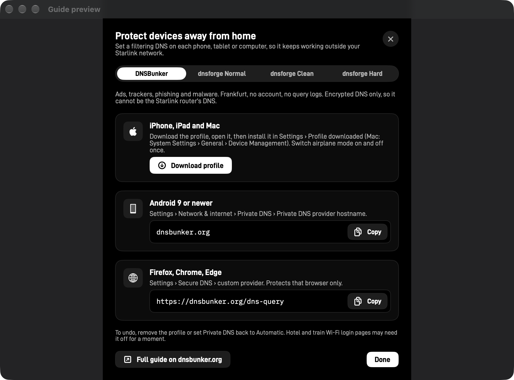

# DNS filtering

The Starlink router cannot block URLs, keywords or HTTPS sites. What it can do is hand every device
a different DNS server. StarPulse uses that: a filtering DNS answers "no such site" for domains on
its blocklists, so those sites do not load on any device that uses the router's DNS.

## Content filtering (as in the Starlink app)

The menu bar popover and **Settings › Router** offer the Starlink app's three options: **No
filtering**, **Malware** and **Malware and adult content**. Per Starlink's help center, the feature
"works by setting a custom DNS server provided by Cloudflare (Cloudflare for Families)"
([Starlink: Content Filtering](https://starlink.com/support/article/1542bce8-8fa4-158f-5880-2dd366dec075)).
StarPulse writes the same addresses ([Cloudflare: Set up 1.1.1.1](https://developers.cloudflare.com/1.1.1.1/setup/)):

| Option | IPv4 | IPv6 |
|---|---|---|
| No filtering | router default (list cleared) | router default |
| Malware | `1.1.1.2`, `1.0.0.2` | `2606:4700:4700::1112`, `2606:4700:4700::1002` |
| Malware and adult content | `1.1.1.3`, `1.0.0.3` | `2606:4700:4700::1113`, `2606:4700:4700::1003` |

Choose an option and press **Save**. The change needs your Starlink sign-in, goes only to the router
on your account, and is read back from the router afterwards. A filter chosen here also becomes the DNS
that DNS rules return the network to.

## Network presets (set on the router)

| Preset | Blocks | IPv4 servers |
|---|---|---|
| Cloudflare for Families (home default) | Malware, phishing and adult content | `1.1.1.3`, `1.0.0.3` |
| Quad9 | Malware only | `9.9.9.9`, `149.112.112.112` |
| dnsforge Normal | Ads, trackers and malware | `49.12.67.122`, `91.99.154.175` |
| dnsforge Clean | Ads, trackers, malware, adult content and gambling, with SafeSearch | `49.12.223.2`, `49.12.43.208` |
| dnsforge Hard | Strict lists with no exceptions; some sites may break | `49.12.222.213`, `88.198.122.154` |

Each preset also sends two IPv6 servers. The full lists are in
[`Sources/StarPulseCore/DnsProfiles.swift`](../Sources/StarPulseCore/DnsProfiles.swift).
Provider pages: [Cloudflare for Families](https://one.one.one.one/family/),
[Quad9](https://quad9.net), [dnsforge](https://dnsforge.de).

### How DNS rules work

1. Create a rule: **Network → Rules → New rule → DNS filter**, then choose a preset, days and hours
   (or "always").
2. While a rule's window is open, StarPulse sets the router to that preset. When no DNS rule is open,
   it returns the router to the home default (Cloudflare for Families).
3. If several DNS rules overlap, the first one in the list wins.
4. StarPulse **only changes the DNS when the router's current list is one of the presets**. If you set
   a custom DNS in the Starlink app, StarPulse leaves it alone.
5. The change is sent through your Starlink account (sign-in required). Devices may keep the old
   DNS until they reconnect or renew their network lease.

## Per-device filtering (works away from home)

**Network → Rules → Protect devices away from home…** opens a guide for encrypted DNS on each device.
It covers:

| Service | Blocks | Notes |
|---|---|---|
| [DNSBunker](https://dnsbunker.org) | Ads, trackers, phishing and malware | Encrypted DNS only, so it cannot be the router's DNS |
| [dnsforge](https://dnsforge.de) Normal, Clean, Hard | As in the table above | Same lists as the network presets |

For each one the guide gives:
- **iPhone, iPad and Mac**: a configuration profile from the provider's site. dnsforge lists its
  profiles for iOS.
- **Android 9 or newer**: the Private DNS hostname to paste.
- **Firefox, Chrome, Edge**: the DNS-over-HTTPS address for the browser's secure DNS setting. This
  protects that browser only.

## Limits

- DNS filtering is a filter, not a lock. A device can use its own DNS, a VPN, iCloud Private Relay
  or a browser's secure DNS and skip the router's filter.
- It blocks whole domains. It cannot block one page, one video or a keyword.
- The router uses one DNS list for every device. There is no per-device DNS on the Starlink router.
- Rules run only while StarPulse is open on a Mac connected to that network.
- The DNS write uses an unofficial Starlink endpoint and may stop working after a firmware change.
